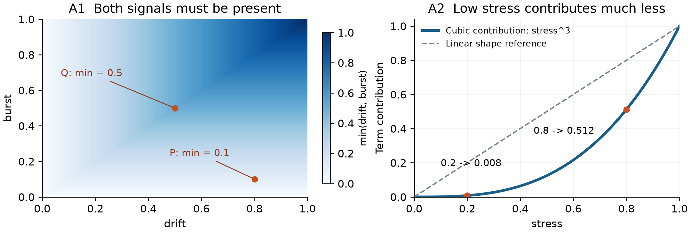

# Cross-Domain Skill Composition: 먼저 결과물 보기

**두 신호의 최소값을 반영하는 큐 정책, 세제곱 스트레스를 반영하는 열 관리 정책.** 이번 논문은 실제 생성식이 어떻게 작동하고, 무엇을 후속 검토할 만하다고 판단했는지를 중심으로 읽을 수 있습니다.

[국문 핵심 사례 읽기](v1.4.0/case_highlights_ko.md) · [최신 논문 PDF](v1.4.0/paper.pdf) · [전체 1,080개 목록 다운로드](https://github.com/7065616b/symbolic-policy-framing-pilot/releases/download/v1.3.0/catalog.html)

그림은 실제 생성식의 수학적 동작을 설명합니다. 새 환경 실험이나 현실 효용의 검증 결과가 아닙니다.

| 산출물 | 흥미로운 점 | 후속 판단 |
| --- | --- | --- |
| A1 최소값 결합 | 한 신호만 커서는 우선순위가 크게 올라가지 않음 | 대응 중립 식보다 작은 구문과 높은 저장 보상: 우선 검토 |
| A2 세제곱 스트레스 | 낮은 스트레스의 기여를 상대적으로 줄임 | 더 단순한 세제곱 대안 대비 작은 이득이 복잡도를 정당화하는지 검토 |
| A5 계수 수정 | 기준식보다 평균 점수가 높아도 더 좋은 대안이 있음 | 더 단순하고 높은 점수의 대응 중립 대안보다 후순위 |

생물학·HCI 탐색 관점과 미니멀 디자인 지침은 프롬프트에 함께 제시됐습니다. 모델은 수학 힌트·문법·변수·피드백 안에서 식을 생성했습니다. A1/A2의 구조는 H에 그대로 없지만 중립 조건에서도 관측돼, 이종 도메인 지시의 인과적 효과를 입증하지 못합니다. 원래 주 대비 X_ROLE−N_ROLE **−0.1111**도 그대로 유지합니다. 좋은 사례만으로 조건 전체의 우위를 주장하지 않습니다.

## v1.4.0 자료

- [논문 PDF](v1.4.0/paper.pdf) / [원고 Markdown](v1.4.0/main_submission_final.md) / [LaTeX 소스](v1.4.0/manuscript-source-v1.4.0.zip)
- [국문 핵심 사례](v1.4.0/case_highlights_ko.md) / [저장 자료 분석 보고서](v1.4.0/analysis_report.md)
- [새 분석·재현 코드](v1.4.0/interesting-analysis-v1.4.0.zip) / [파일 해시](v1.4.0/SHA256SUMS.txt)
- [v1.3 전체 목록·원문 카드·선정 기록](https://github.com/7065616b/symbolic-policy-framing-pilot/releases/download/v1.3.0/artifact-analysis-v1.3.0.zip) / [국문 전체 사례 카드](case_cards_ko.md)
- [원자료](https://github.com/7065616b/symbolic-policy-framing-pilot/releases/download/v1.3.0/public-supplement-v1.0.0.zip) / [이전 복잡도·다양성 분석](https://github.com/7065616b/symbolic-policy-framing-pilot/releases/download/v1.3.0/composition-analysis-v1.2.0.zip)

분석 ZIP README에 내려받은 이전 자료와 함께 재현하는 명령이 있습니다. 새 분석은 다섯 고정 사례의 모든 대응 조건 비교 30개와 두 문자열 구조의 출현 세션을 다룹니다. 600개 동일 시험 시드는 고정 정책의 변동을 설명하며 독립적인 모델 생성 표본이 아닙니다. 사례는 사후 선정됐고 판단은 탐색적입니다.

90세션, 1,080개 제출식, 822개 도메인·원문 문자열 조합을 보존했습니다. 944개에는 저장된 시험값이 있고 136개는 미시험입니다. 이 수는 독립적인 발명 수나 성공률이 아닙니다. 원자료와 [v1.3.0 릴리스](https://github.com/7065616b/symbolic-policy-framing-pilot/releases/tag/v1.3.0)를 포함한 이전 릴리스는 변경하지 않았습니다. 이번 개정에는 새 연구 모델 호출·환경 trace·통계 시뮬레이션이 없습니다.
