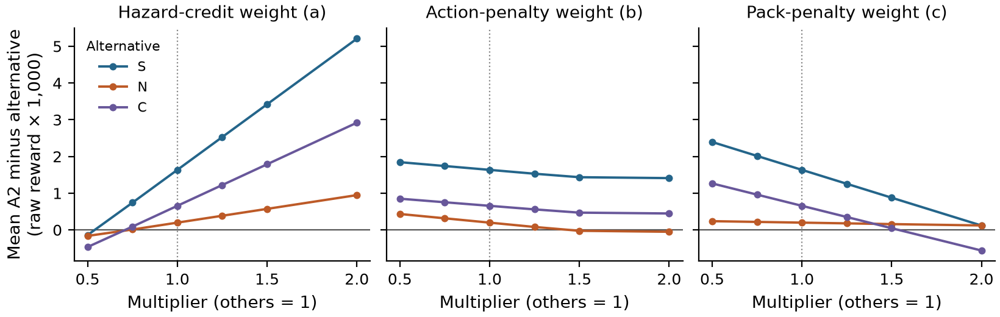

# A2는 어떤 기준에서 검토할 만한가

**A2는 현재 합성 보상 기준의 후속 검토 후보입니다. 평가 기준이 달라져도 우세한 정책으로 보기는 어렵습니다.**

[논문 PDF](paper.pdf) · [전체 민감도 분석](sensitivity_report_ko.md) · [재현 코드·입력·결과](a2-sensitivity-analysis-v1.10.0.zip)

## 이번에 확인한 것

- 같은 A2/S/N/C와 기존 600개 시드를 36개 고정 보상 설정으로 재평가했습니다. 새 모델 호출·정책·시험 시드는 없습니다.
- 개별 가중치 ±25% 변경에는 평균 1위를 유지하지만, 동시 변경 27개 조합에서는 22개 1위·3개 2위·2개 3위입니다. N에 4개, C에 3개 조합에서 뒤졌습니다.
- 위험 지표 보상 가중치를 절반으로 낮추면 네 정책 중 마지막입니다. 이 격자의 개수를 성공 확률이나 모든 가중치의 보장으로 해석하지 않습니다.

세 그림은 각각 한 가중치만 바꾸고 다른 두 개는 유지합니다. 세로 값은 원시 보상 차이를 보기 쉽게 1,000배 표시한 것이며 백분율이 아닙니다. 점 사이의 선은 측정된 점을 연결합니다.

## 무엇을 넣었고 무엇이 달라졌나

| 구분 | 내용 |
| --- | --- |
| 제공 | 생물학·HCI·미니멀 디자인 지침, 변수·문법·피드백, 온도·곱·스트레스 임계 힌트 |
| 관찰된 변화 | 온도와 곱 유지, 곱 계수 0.5, 임계 항 대신 세제곱. 직전 출력의 곱 계수 1에서 0.5로 변경 |
| 미확인 | 특정 도메인 지식의 세제곱 항으로의 전이, 모델 내부 추론, 수학적 최초성, 현실 효용 |

세제곱은 이전 라운드 출력과 피드백에 이미 들어 있었고 중립 조건에서도 발생했습니다. [실제 최초 프롬프트](source_prompt_A2.json)와 [구분 기록](provenance_A2.json)을 함께 공개합니다.

## 최종 판단

S보다 원래 평균이 높지만 여섯 노드 더 큽니다. N보다 두 노드 작지만 작은 평균 차이가 보상 기준에 따라 뒤집힙니다. C와는 같은 크기에서 가중치가 다르며 이 선호도 뒤집힙니다. **조건부 검토 후보로 남기고, 기본 대체 정책으로 채택하는 판단은 보류합니다.**

핵심 발견은 후보의 가치가 비교 대상과 평가 목적에 달려 있다는 점입니다. 이종 도메인 지침 아래 어떤 산출물이 나왔고 어떻게 판단할지를 보여주는 탐색 연구입니다. 결합 효과나 실제 안전 개선을 입증하지 않습니다. 원래 전체 대비 −0.1111과 기존 한계를 유지합니다.

보상 하한을 매 단계 다시 적용했고 86,400개 재평가값이 직접 실행과 정확히 일치합니다. 이는 같은 경로를 반복 평가한 수이며 독립 표본 수가 아닙니다. [검증](sensitivity_verification.json) · [해시](SHA256SUMS.txt) · [이전 전체 시드 손익](../v1.9.0/case_highlights_ko.md) · [전체 산출물 목록](https://github.com/7065616b/symbolic-policy-framing-pilot/releases/download/v1.3.0/catalog.html)
