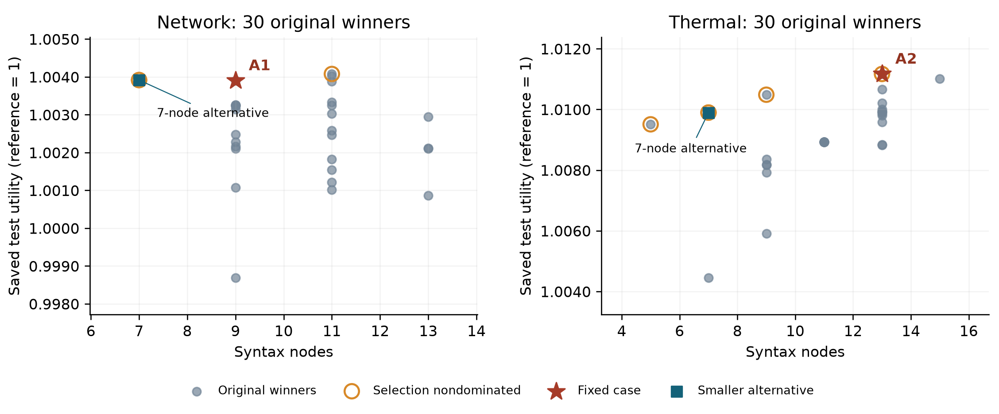

# 전체 대안과 손실까지 보면 판단이 어떻게 달라지는가

생물학·HCI 탐색 관점과 미니멀 디자인 지침을 결합한 프롬프트에서 나온 식을 검토합니다. 모델에는 수학 힌트·변수·문법·피드백도 제공됐습니다. 이번에는 관심 사례를 같은 과제의 **원래 선택 정책 30개 전체**와 비교했습니다. 전체 제출식 360개는 순위와 시험값 보유 범위를 보는 보조 분석이며, 모든 제출식에 새 시험을 한 것은 아닙니다.

[논문 PDF](paper.pdf) · [전체 대안·이득·손실 보고서](analysis_report.md) · [분석·재현 코드](alternatives-analysis-v1.5.0.zip)

## 먼저 용어

X는 이종 도메인 문구, N은 중립 문구입니다. ROLE은 탐색과 단순화에 역할을 나누고, FLAT은 함께 제시합니다. 한 블록에는 같은 과제의 조건별 세션이 하나씩 있습니다. 원래 선택 정책은 각 세션의 후보 중 선택 자료로 고른 식입니다. Utility U=1은 단순 기준식의 평균 보상이며 클수록 높습니다. 노드는 식의 크기이고 실행 시간이 아닙니다. 시험 경로 600개는 고정 정책을 평가한 합성 환경의 변동이며 모델을 600번 독립적으로 실행한 표본이 아닙니다.

## A1 — 동작은 흥미롭지만 더 단순한 대안이 있다

`queue+min(drift,burst)-0.5*idle`

두 신호 중 작은 값이 추가 우선순위를 제한하므로, 한 신호만 높아서는 기여가 커지지 않습니다. 같은 블록의 중립 역할 정책보다 식이 작고 평균도 높았지만, 비교 범위를 넓히면 판단이 달라집니다.

- Network의 원래 선택 정책 30개에서 선택·시험 평균 모두 **5위**입니다.
- `queue+drift-0.5*idle`은 **7노드**로 A1의 9노드보다 작고, 선택·시험 평균도 아주 조금 높습니다. 이 정확한 식은 중립 조건의 두 세션에서 나왔습니다.
- A1과 이 대안을 같은 600개 경로에서 비교하면 **9승·569동률·22패**, 평균 raw 보상 차이 **−0.00001176**입니다. 같은 총보상은 같은 행동을 했다는 뜻까지는 아닙니다.
- 따라서 A1은 최소값 결합의 동작을 설명하는 사례로 남기되, 평균 보상과 식 크기를 기준으로 우선 채택할 이유는 약합니다. 작은 점수 차이가 실무적으로 중요하다고 주장하지 않습니다.

## A2 — 관측 평균은 가장 높지만 손실도 확인해야 한다

`temp+(0.5*(soc*imped)+stress*stress*stress)`

세제곱은 낮은 스트레스의 기여를 상대적으로 줄입니다. stress 0.2는 0.008, 0.8은 0.512로 반영됩니다. Thermal 원래 선택 정책 30개에서 선택·시험 평균 모두 **1위**였습니다. 그러나 더 단순한 `temp+stress*stress*stress`도 있습니다.

- A2는 **13노드**, 단순 대안은 **7노드**입니다.
- 동일 600개 경로에서 **390승·210패**, 평균 raw 보상 차이는 **+0.001635**입니다.
- 이득 기여 **+0.002580**에서 손실 기여 **0.000945**를 빼면 그 평균이 됩니다. 두 기여는 각각 양의 차이와 음의 차이 절댓값을 모든 600개 경로로 나눈 값입니다.
- 가장 불리한 30개 경로의 평균 차이는 **−0.006591**, 관측 최대 손실은 **0.010608**입니다. 미래의 손실 한도나 위험 확률은 아닙니다.
- 따라서 후속 검토할 후보이지만, 이 작은 평균 이득을 위해 복잡도와 손실을 감수할지는 별도로 판단해야 합니다. 허용 손실이나 실무적으로 필요한 최소 이득은 정하지 않았습니다.

점은 원래 선택 정책이며, 중복된 점은 겹칩니다. 주황색 테두리는 선택 자료에서 식 크기·보상 기준으로 지배되지 않는 정책을 표시하고, 세로 위치는 저장된 시험 평균입니다. 시험값으로 새 정책을 선택하지 않았습니다.

## 전체 제출식과 한계도 함께 보기

| 사례 | 원래 선택 정책: 선택/시험 순위 | 전체 제출 선택 순위 | 시험값이 있는 제출식 내 시험 순위 | 미시험 |
| --- | --- | --- | --- | --- |
| A1 | 5/30 · 5/30 | 7/360 | 7/327 | 33개 |
| A2 | 1/30 · 1/30 | 1/360 | 1/306 | 54개 |

순위는 반복 제출을 포함하며 고유 발명 수가 아닙니다. 미시험은 실패로 취급하지 않습니다. A2의 ‘1위’는 관측한 범위의 평균 순위이며, 전역 최적이나 현실적 우수성을 의미하지 않습니다. 모든 대안은 같은 과제 안에서만 비교합니다.

A3는 제공된 cap과 작은 차이를 진단하는 사례, A4는 제공 힌트의 조합 사례로 유지합니다. A5는 기준식보다 높아도 더 단순한 중립 대안보다 낮아 후순위입니다. A5의 대응 대안 대비 결과는 270승·2동률·328패, 평균 raw 차이 −0.001764입니다.

두 핵심 구조는 수학 힌트에 그대로 없었지만 중립 조건에서도 나타났습니다. 원래 X_ROLE−N_ROLE 주 대비 **−0.1111**도 유지합니다. 생물학·HCI·디자인 지식이 이 구조를 만들었다는 인과 효과, 최소값·세제곱 항만의 효과, 실제 배포 효용이나 실행 속도 향상은 입증되지 않았습니다. 이번 비교는 사후 선정된 고정 사례와 저장된 합성 결과의 분석입니다.

[원래 사례 5개와 출처](../case_cards_ko.md) · [전체 1,080개 목록](https://github.com/7065616b/symbolic-policy-framing-pilot/releases/download/v1.3.0/catalog.html) · [이전 대응 조건 분석](../v1.4.0/analysis_report.md) · [파일 해시](SHA256SUMS.txt)
