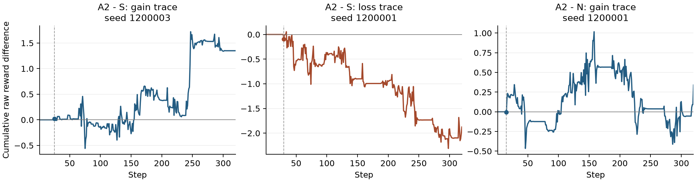

# Cross-Domain Skill Composition: An Exploratory Study of Generated Policies

**Bogyun Kim**  
Department of Computer Engineering, Mokpo National University, Muan, Republic of Korea  
`s11s45@naver.com`

## Abstract

We report an exploratory study of symbolic policies generated under prompt-level composition of biological/HCI exploration and minimalist-design guidance. Within five fixed retrospective cases, thermal-priority policy A2 is the central candidate: it has the highest observed mean among 30 original Thermal winners, but its value depends on the alternative. It beats a seven-node cubic policy on 390 of 600 saved traces; against the strongest selection-ranked neutral winner, the count narrows to 308, with a small mean margin and two fewer nodes. Observer-instrumented local replay exactly reproduces all 2,400 saved policy-seed rewards for A2 and three fixed alternatives. Recorded choices reveal both gains and losses from reweighting supplied features; one trace gains overall despite losing at its first differing action. Replay adds diagnostics, not independent observations. A1 shows how broader comparison weakens an initially favorable judgment. Both highlighted structures occur in neutral conditions, and the original framing contrast remains -0.11 near-reference components per session. The contribution is a reproducible assessment of generated candidates, their alternatives and their observed tradeoffs. Cross-domain causation and practical utility remain unresolved.

**Keywords:** Cross-domain skill composition, symbolic policies, exploratory study, candidate evaluation.

## 1. Introduction and Related Work

An interesting generated rule should be something a reader can inspect, explain and compare with an alternative. The possibility of combining perspectives from unrelated domains motivates this work. Our exploratory question is which policies generated under that setting merit further examination when their inputs, alternatives and losses are made explicit. We combine biological immune-adaptation and human-computer interaction (HCI) reframing with minimalist industrial-design guidance. The source domains are named by the prompt; the model chooses expressions within a supplied grammar, task facts, mathematical hints H and feedback. Here skill composition means textual guidance in one prompt, not independently executed agents or unconstrained discovery of source domains.

For reading the comparisons, **X** names cross-domain wording and **N** neutral wording. **ROLE** assigns exploration and simplicity distinct functions; **FLAT** combines the guidance. These are prompt conditions, not separate agents. **H** denotes supplied mathematical hints. A **block** contains one session per condition on the same task. Each session has one **original winner**, chosen on selection data before test access. **Utility U** is mean reward divided by the same task's reference mean; U=1 is the simple reference and larger is better. **Nodes** measure expression size, not runtime. A **trace** is one 320-step synthetic environment run; it is not an independent model generation.

A2 leads the narrative as a candidate with a favorable observed mean and unresolved size/loss tradeoffs. A1 follows as a case whose adoption judgment changes when comparison expands beyond its original block. This emphasis is editorial and retrospective within the five already fixed cases; it does not select a new policy on test results. Section 2 explains the outputs and Section 3 supplies the saved comparisons, alongside the unchanged aggregate evidence in Section 5.

LLM-driven executable search has precedents in FunSearch [1], Evolution of Heuristics [2] and ReEvo [3]. Analogical prompting [10] and cross-domain scientific search [7] motivate source perspectives; CreativeDC [6] combines divergent and convergent instructions. HSEvo [4], Language Model Crossover [5] and MAP-Elites [9] address diversity alongside quality; persona effects are task-dependent [8]. Our contribution is a traceable case study of generated structures and decisions about their value, not a new search or analogy algorithm. An older 414-expression corpus is excluded because its generation requests are unavailable.

## 2. A2 as a Candidate and A1 under Broader Comparison

The common cross-domain instruction names biological immune-adaptation and HCI reframing for exploration, with minimalist industrial-design guidance for concise expressions. It asks the model to interpret supplied templates; it adds no physical laws or mathematical rules. Table 1 separates those templates from the submitted expressions and the alternatives used to judge them. A1/A2/A3/A5 use X_ROLE; A4 uses X_FLAT. Their presence here records outputs under those prompts, not the origin of the model's internal knowledge.

| Case | Supplied input H | Exact generated expression | Comparison alternative | Author judgment |
| --- | --- | --- | --- | --- |
| A2 | `soc*imped`; `max(stress-0.5,0)`; temperature | `temp+(0.5*(soc*imped)+stress*stress*stress)` | `temp+stress*stress*stress` (X_FLAT; 7 nodes) | Central follow-up candidate: highest observed mean, with extra size and losses |
| A1 | `queue*(0.45+drift)`; `max(burst-idle,0)`; negative idle | `queue+min(drift,burst)-0.5*idle` | `queue+drift-0.5*idle` (neutral; 7 nodes) | Broader comparison weakens the initial adoption argument; a smaller alternative scores slightly higher |
| A3 | `cost*freq`; `min(freq-0.5,0.25)`; positive jitter with idle | `idle-0.35*min(freq-0.5,0.25)+0.2*jitter` | `idle` (reference) | Low-priority diagnostic: supplied cap and tiny reference margin |
| A4 | Same Thermal H as A2 | `temp+soc*imped+2*max(stress-0.5,0)` | `temp+soc*imped+max(stress-0.5,0)` (matched X_ROLE) | Assembly/control example: supplied terms, with higher size and mean |
| A5 | Same Network H as A1 | `queue*(0.35+drift)-0.25*idle` | `queue+drift-0.5*idle` (matched N_ROLE) | Deprioritize: the smaller alternative scores higher |

*Table 1. Input, exact output, comparison and judgment for all five fixed cases; A2 is presented first and original case IDs are retained. H entries summarize the supplied mathematical hints; the source-domain instruction above, task facts, grammar and session feedback are also inputs. Input-output differences do not identify a biological/HCI mechanism. A1's alternative comes from the full winner set; A2/A4/A5 use matched-block alternatives and A3 uses the reference. These are reasons for further examination or deprioritization, not deployment decisions. Additional A2 alternatives N and C appear in Section 3.2.*

### 2.1 A2: Central Candidate for Further Examination

A2 ranks four synthetic modules for derating using temperature, half the supplied soc*imped interaction and cubic stress. Here soc denotes state of charge and imped impedance. Its highest observed mean among original Thermal winners motivates follow-up, subject to size and loss tradeoffs. On normalized [0,1] inputs, cubing reduces stress except at the endpoints; H supplies a positive-part threshold instead. This is a generated shape within the grammar, not an identified biological/HCI mechanism.

The seven-node alternative S is temp+stress*stress*stress, omitting the product. We also fix a neutral threshold policy N and a same-size cubic policy C, specified in Section 3.2. We replay these four existing policies on all 600 original test seeds for 320 steps. An observer records inputs, choices and reward components without changing the original transitions or random draws. All 2,400 policy-seed means match the saved rewards and the uninstrumented simulator exactly; all 600 reference rewards also match. These are additional diagnostics of existing synthetic observations, not new independent tests.

For each alternative we illustrate the smallest base seed with positive A2-minus-alternative mean reward and the smallest with negative mean reward, using tolerance 1e-12. We then inspect the first differing action. This retrospective sign-conditioned rule avoids maximizing the displayed difference but does not make the six pairs representative. Table 2 shows the two selected modules for S; all four inputs and complete trajectories are public.

| Trace / step | Module (chosen by) | temp | soc | imped | stress | S score | A2 score |
| --- | --- | ---: | ---: | ---: | ---: | ---: | ---: |
| Gain / 25 | 3 (A2) | 0.456673 | 0.576453 | 0.224144 | 0.317894 | 0.488798 | 0.553402 |
| Gain / 25 | 4 (S) | 0.461809 | 0.571182 | 0.185761 | 0.308865 | 0.491274 | 0.544326 |
| Loss / 30 | 1 (S) | 0.540988 | 0.593125 | 0.262826 | 0.348180 | 0.583197 | 0.661141 |
| Loss / 30 | 4 (A2) | 0.462533 | 0.613333 | 0.301407 | 0.482664 | 0.574977 | 0.667408 |

*Table 2. Recorded normalized inputs and scores at the first action divergence from S. Gain is base seed 1200003, step 25; loss is seed 1200001, step 30. Steps and modules are one-based. Both policies have identical pre-action states at these points; values are rounded from full precision. The selected module has the highest score among all four modules. Scores are not rewards, and these are synthetic replay states, not physical measurements.*

In the gain trace, S chooses module 4, while the larger product contribution moves A2 to module 3. Their immediate rewards are 0.757709 and 0.777924, respectively. In the code's reward calculation, the larger hazard-mitigation credit outweighs a slightly larger remaining-pack penalty. The immediate A2 margin is +0.020215; the entire trace's mean margin is +0.004218.

In the loss trace, S chooses hotter module 1, while A2 chooses module 4 with higher soc, imped and stress. A2's hazard-mitigation credit is lower and its remaining-pack penalty is higher. Immediate rewards are 0.792774 for A2 and 0.884275 for S, a margin of -0.091501; the trace mean is -0.005861. Both first-divergence examples have zero unnecessary-derating penalty and no reward-floor clipping.

Accounting across all 320 steps also connects these choices to outcomes: in the S gain trace, the mean hazard-credit contribution +0.005882 outweighs the pack-penalty contribution -0.001664; in the loss trace both are unfavorable, -0.004713 and -0.001148. Other reward-component differences are zero in these two traces. This is accounting along the observed paths, not an isolated term intervention or validated thermal protection.

Figure 1 shows why a single choice cannot explain a whole trace. Against N, seed 1200001 first differs at step 15: A2 chooses module 4 instead of module 1 and loses 0.007360 immediately, yet its full-trace mean margin is +0.001062. After the first differing action, states can diverge. Later same-seed steps need not compare the same input state, and their differences do not isolate a single-term effect.

The saved generation sequence remains visible: round 3 slot 9 contains temp+(soc*imped+stress*stress*stress); round 4 halves the product coefficient after that output and its feedback are supplied. The record does not identify the model's internal rationale.

*Figure 1. Cumulative raw reward differences from deterministic replay of existing test seeds. Dashed lines and dots mark the first differing action. Panels use the stated sign-conditioned rule, not the largest gains/losses. The N trace starts with an immediate loss at divergence but ends positive; the mean margin is the final cumulative difference divided by 320. Later paths may contain different states. All six trace pairs are available in the supplement.*

### 2.2 A1: Broader Comparison Changes the Judgment

A1 ranks synthetic queues by adding the smaller of drift and burst to queue, then subtracting half idle. Both signals must be high for a large added priority. This exact minimum coupling is absent from H. Take two invented normalized queues with queue=0.6 and idle=0.1: P has drift=0.8 and burst=0.1; Q has drift=0.5 and burst=0.5. A1 scores them 0.65 and 1.05, selecting Q, whereas the reference scores them 0.960 and 0.885, selecting P. This is a decision illustration, not evidence that Q is better in practice.

The same-block comparison initially favors A1: nine nodes and test U=1.003905 versus 13 nodes and U=1.000870 for N_ROLE. Expanding to all original winners reveals the seven-node neutral alternative in Table 1. Section 3 shows why the larger comparison set weakens the adoption judgment even though the minimum rule is easy to explain.

The saved sequence records a coefficient change: round 2 slot 6 contains `queue+min(drift,burst)-0.25*idle`; round 3 changes -0.25 to -0.5 after that output and its feedback are supplied. The sequence establishes the visible revision, not its internal rationale.

### 2.3 A5: Above Reference Is an Incomplete Adoption Argument

A5 changes a supplied queue template's coefficients and omits burst. Its test U=1.002104 exceeds the simple reference, but the matched neutral expression in Table 1 reaches 1.003917 with seven nodes/depth 2 versus nine/depth 3. This comparison motivates deprioritization rather than labeling A5 a failed generation. Paired outcomes are retained in Section 3.2.

A5 was fixed by the low-selection rule, not chosen for a poor test outcome. The preceding round has `queue*(0.4+drift)-0.3*idle`; A5 revises the coefficients after feedback.

### 2.4 A3 and A4: Supplied Structures Remain Visible

A3 adjusts idle with an upper-capped frequency term and positive jitter, both supplied in H. For freq below 0.5, subtracting the negative min term adds a bonus; at freq at least 0.75 the contribution is fixed at -0.0875. Earlier rounds use cap weights 1 and 0.6; A3 uses 0.35. Test U=1.000466 and depth 4, above the soft target of 3, make it a low-priority diagnostic rather than evidence of cloud-cost savings.

A4 combines the supplied temperature, soc*imped and threshold terms, doubling the threshold weight. The preceding round contains both the doubled threshold without the product and the product with weight one. Test U=1.009928 exceeds the matched X_ROLE winner's 1.008923, with 13 nodes/depth 4 versus 11/depth 3. It is an X_FLAT assembly/control example, not a newly established domain connection.

## 3. Comparison with All Original Winners

### 3.1 Position among Original Winners and All Submissions

We first place each fixed case among all 30 original winners in its own task: six blocks times five conditions. We audit all 90 winners, but do not pool Network, Thermal and Cloud utilities. Duplicate expressions remain separate session outcomes; the 30 Network and Thermal winners contain 28 and 26 distinct exact strings. A rank is one plus the number of strictly higher utilities, with 1e-12 tolerance and ties retained. Selection and test ranks are computed separately. These descriptive ranks do not select new policies or estimate a generation effect.

We also compare expression size and utility. An alternative dominates a policy when it uses no more nodes and has no lower utility, with at least one strict difference. We assess this relation first on selection data and separately on saved test data. This numerical rule has no minimum practical effect threshold; a tiny score difference can change the status.

| Case | Winner rank: selection/test | Size-reward dominated: selection/test | All submissions: selection rank | Tested submissions: test rank |
| --- | --- | --- | --- | --- |
| A2 | 1/30; 1/30 | No; No | 1/360 | 1/306 |
| A1 | 5/30; 5/30 | Yes; Yes | 7/360 | 7/327 |

*Table 3. Same-task positions of fixed cases. The final two columns retain submitted occurrences, including repeats; 33 Network and 54 Thermal submissions have no saved test value. Ranks among available test values are not ranks over all 360 submissions. The analysis does not treat missing values as failures or claim a global optimum.*

A2 is not dominated: its test U=1.011170 exceeds the simpler cubic alternative's 1.009897, with 13 rather than seven nodes. A1's two dominators are instances of the same seven-node expression, from Network N_ROLE block 5 and N_FLAT block 6. Its test U=1.003917 is only about 0.000012 above A1; the selection advantage is approximately 4.38e-8. Expression size, rather than a demonstrated practically important score increment, drives the preference. We describe the first instance by session ID; both have identical formulas and stored traces.

*Figure 2. All 30 original winners per focal task plotted by saved test utility and syntax nodes. Duplicate points overlap; outlined circles mark policies not dominated on selection data, then displayed at their saved test values. Stars mark the fixed cases; squares mark the discussed smaller alternatives. The figure is descriptive and does not reselect policies on test data.*

The secondary ranks in Table 3 cover all 360 submissions per task, with test denominators restricted to available values. Coverage depends on the original evaluation procedure, not random sampling. The analysis files give ranks, exact strings and dominators for all 90 winners, plus their positions and task coverage among submitted occurrences. Per-seed comparisons concern the 30 winners per task; the 360-submission view supplies ranks only.

### 3.2 Average Gains and Observed Downside

A2's additional alternatives are fixed from original winners using selection data: N is the highest-mean neutral Thermal winner, block 6 N_FLAT, temp+0.5*soc*imped+1.5*max(stress-0.5,0), with 15 nodes; C is the highest-mean other 13-node Thermal winner containing the literal cubic motif, block 2 X_FLAT, temp+stress*stress*stress+0.1*soc*imped. S retains the previously fixed matched-block seven-node comparator. These retrospective diagnostics do not optimize coefficients or select a new policy. A2 is two nodes smaller than N with a slightly higher mean, but 308 wins versus 292 losses; C shares its cubic-product form and differs in weighting. Thus the comparisons qualify candidate value without establishing a unique domain connection.

For each case, we subtract each same-task alternative's raw reward on the identical saved seed. This gives 30 comparisons including self, plus the reference, or 62 comparisons across A1/A2. The within-block contrast remains identifiable, while comparisons to other blocks describe fixed policies rather than paired generation interventions. All joins require 600 matching seeds and equal reference rewards.

A win has a difference above 1e-12; a tie is within that tolerance. Table 4 shows the mean difference, the mean of the 30 lowest differences (observed bottom 5%) and the largest observed loss. These are task-specific raw-reward quantities, not percentages. They describe this set of traces, not a bound on future risk or 600 independent model generations.

| Case | Comparator | Wins/ties/losses | Mean difference | Lowest-30 mean | Largest loss |
| --- | --- | --- | ---: | ---: | ---: |
| A2 | Reference | 599/0/1 | +0.014354 | +0.005077 | 0.000154 |
| A2 | S: X_FLAT B5, 7 nodes | 390/0/210 | +0.001635 | -0.006591 | 0.010608 |
| A2 | N: N_FLAT B6, 15 nodes | 308/0/292 | +0.000198 | -0.006281 | 0.008701 |
| A2 | C: X_FLAT B2, 13 nodes | 342/0/258 | +0.000656 | -0.006834 | 0.012074 |
| A1 | Reference | 514/0/86 | +0.003800 | -0.003681 | 0.007333 |
| A1 | N_ROLE B4: same block | 402/0/198 | +0.002953 | -0.004802 | 0.009958 |
| A1 | N_ROLE B5: simpler | 9/569/22 | -0.000012 | -0.000306 | 0.001276 |

*Table 4. Gain and downside on saved common-seed traces. B denotes block. A negative lowest-30 mean indicates losses in that tail; largest loss is reported as a positive magnitude. The A1 seven-node comparator is identified by the selection-data dominance relation, not by searching test outcomes. The full supplement retains all 62 comparisons, medians, fifth percentiles and conditional gains/losses. S/N/C do not add comparisons to that set; their new step records come from local replay.*

The earlier comparisons for the other fixed cases are retained: A3 versus reference has 359 wins, no ties and 241 losses, with mean raw margin +0.000412; A4 has 599/0/1 and +0.012758. A5 versus its same-block N_ROLE alternative has 270/2/328 and -0.001764. Their complete matched-condition records remain in the v1.4 analysis.

Gain/loss contributions explain the averages. For A2 versus the simpler cubic rule, +0.002580 gain contribution minus 0.000945 loss contribution gives +0.001635. Against the same-block N_ROLE winner, A1's +0.003617 minus 0.000664 leaves +0.002953; against the smaller cross-block rule, +0.00000355 minus 0.00001530 gives -0.00001176. Contributions divide all positive and absolute negative differences by 600, including differences within the tie tolerance; the supplement also gives conditional averages over only the corresponding signed cases.

These results qualify A2's candidate status: its positive mean coexists with losses against a smaller policy. A1 shows how expanding the comparator set can change an initially favorable adoption judgment. Equal total rewards do not establish identical actions. No acceptable loss or minimum useful gain was specified, so neither tradeoff is labeled practically acceptable. Whole-formula reward differences do not isolate the effect of min or the cubic term.

### 3.3 Interesting Structures Are Not Exclusive to Cross-Domain Roles

We also audit two explicitly defined motifs throughout the complete saved catalogue. After removing whitespace, we search for the exact substrings `min(drift,burst)` in Network and `stress*stress*stress` in Thermal. This is a narrow, reproducible string census, not semantic clustering or an exhaustive search for algebraically equivalent rules. Counts are retrospective and were chosen because of A1/A2.

The minimum motif appears in four X_ROLE submissions from one session, one N_ROLE submission from one session and one X_FLAT submission from one session. It is absent under this literal rule in N_FLAT and DOMAIN_V2. The cubic motif appears in seven X_FLAT submissions from five sessions, three N_FLAT submissions from one session and two X_ROLE submissions from one session; it is absent under the rule in N_ROLE and DOMAIN_V2. Each task/condition has six sessions and 72 submissions. Repeated submissions from a session are not independent discoveries.

These records sharpen the main distinction: a structure can be absent from H, interpretable and promising in a selected comparison without being specific to the cross-domain package. The minimum and cubic motifs are not evidence that biological, HCI or design knowledge caused the corresponding terms. Their neutral-condition occurrence is part of the finding, not an example to omit.

### 3.4 Complete Collection and Retrospective Selection

All 1,080 submissions pass the recorded validity gate. Within domains there are 822 distinct exact expression strings; spacing and algebraic variants remain separate. We retain every occurrence, including repeats, with its session, condition, block, round, slot, exact prompt, prior-answer/feedback request, and response line. The catalogue also records nodes/depth, original selection status, behavioral component, and saved scores. There are 916 component representative instances and 90 original session winners. Test outcomes exist for 944 submissions; the other 136 remain untested, not zero-scoring failures.

The offline catalogue supports expression search and domain, condition, test-availability and original-selection filters. Syntactic tags identify variable-bearing products, min/max, abs, division, or additive-affine forms. They help locate examples but do not establish semantic novelty or a cognitive process. The public case cards retain the exact H beside each case so that supplied building blocks are not credited as discoveries.

We fix three core cases: the original X_ROLE session winner with highest selection utility in each domain. Ties use nodes, depth, session ID and slot ID in ascending order. One X_FLAT complement is selected from original winners with a tag combination absent from the core cases, using Network-Thermal-Cloud domain order and the same ranking within the first eligible domain. One low-selection X_ROLE example uses that domain order, minimum selection utility, and the same tie rules after excluding already used domain/expression pairs. A missing eligible complement would be omitted.

The selection function receives only selection/provenance/syntax fields. It writes case IDs and a rule hash before attaching test values, without replacing cases after attachment. Nevertheless, the rule was devised after pilot results had been inspected: these are **post-hoc descriptive cases, not five prevalidated successes or the global best five outputs**. Matched comparison rows are the original winners of all five conditions in the same domain/block. Full inclusion/exclusion logs are public.

## 4. Inputs, Generation, and Evaluation

### 4.1 Source Perspectives and Target Tasks

The source perspectives and target tasks play different roles. Biological/HCI and design language supplies guidance; Network, Thermal, and Cloud are the tasks receiving generated rules. Network ranks four synthetic queues, Thermal ranks four synthetic modules for derating, and Cloud ranks six synthetic slots for reclamation. In each task, the expression assigns scores to options and the highest score determines the selected option. Features are normalized to [0,1] by clipping negative raw values at zero and applying x/(1+x). Ties retain the first option.

Expressions use four task variables, constants, arithmetic, min, max, and abs. All conditions share a hard gate of 25 AST nodes and implemented depth 5, with soft targets of 14 nodes and depth 3. Recorded depth flattens additive/subtractive and multiplication chains; it is not ordinary binary-tree height. Each environment trace has 320 steps, with handcrafted transitions and rewards; task names do not imply validated physical or production systems.

The four factorial conditions share the hints in Table 6. The cross-domain instruction asks the model to interpret them through biological immune-adaptation and HCI reframing analogies, using minimalist industrial-design inspiration for concise expressions. ROLE assigns exploration and simplicity distinct functions within the same response; FLAT presents both together. These are prompt instructions, not observed internal stages. DOMAIN_V2 omits H and changes the guidance procedure, so it is descriptive rather than a single-module ablation.

| Condition | Framing | Organization | H |
| --- | --- | --- | --- |
| N_FLAT | Neutral | Combined | Yes |
| N_ROLE | Neutral | Roles | Yes |
| X_FLAT | Cross-domain | Combined | Yes |
| X_ROLE | Cross-domain | Roles | Yes |
| DOMAIN_V2 | Domain | Base | No |

*Table 5. Conditions. Every factorial arm includes exploration and simplicity guidance. Roles are textual within one response.*

| Task | Shared mathematical hints H |
| --- | --- |
| Network | `queue*(0.45+drift)`; `max(burst-idle,0)`; negative idle term |
| Thermal | `soc*imped`; `max(stress-0.5,0)`; temperature term |
| Cloud | `cost*freq`; `min(freq-0.5,0.25)`; positive jitter with idle |

*Table 6. H is supplied to all four factorial conditions within a task. The Cloud min term is an upper cap, not a lower clamp. Exact complete prompts and their verbatim differences are public.*

### 4.2 Recorded Generation and Evaluation

The pilot ran on 24 October 2026 (KST), requesting gpt-6.1-sol with low reasoning effort through Codex CLI 0.162.1. Three domains, six paired blocks per domain, and five conditions give 90 separately initialized sessions. Randomized condition order within domain/block and four rounds of three expressions yield 360 responses and 1,080 slots. Each session receives only its own prior answers and feedback. The required response is an expression array without explanatory commentary, so the record does not reveal the model's internal rationale.

The experimental message roles were serialized into one CLI input rather than sent as native API roles. Actual prompt length, semantics, and token use were not exactly matched; the requested 2,048-token output cap was not enforced. Thus the contrasts concern the recorded instruction packages, not perfectly resource-matched interventions or verified server snapshots.

Feedback, selection and test use disjoint base seeds: 48 (1000001-1000048), 96 (1100001-1100096), and 600 (1200001-1200600), with fixed Thermal/Cloud offsets. Selection starts after generation, and selected policies and representatives are frozen before test access. Independent generation comparisons use sessions; each session's 12 submissions are dependent.

The reference expressions are queue+0.45*drift+0.15*burst-0.15*idle for Network, temp+0.4*soc+0.35*imped+0.25*stress for Thermal, and idle for Cloud. Historical labels Adaptive-PI, PID-lite, and Fixed-TTL denote simplified synthetic formulas, not full implementations of those methods. Utility U is the policy's mean trace reward divided by the reference's mean reward on the same domain/split; the reference has U=1. This ratio is not an average of per-trace ratios. References are comparison points, not optima or tuned published competitors.

Behavioral groups use the saved graph on a fixed four-value-per-coordinate grid and 500 diagnostic option panels. An edge requires Spearman score correlation above 0.98 and top-action agreement of at least 95 percent. Connected components may contain transitive chains; they are finite-probe groups within a session, not globally unique ideas. Each representative and the overall session winner are chosen by selection mean reward, with expression-hash and slot tie breaks, then evaluated on test. The original primary outcome counts representatives with U at least 0.99. This near-reference criterion permits below-reference policies and is not a practical improvement threshold. Strict exceedance uses U greater than 1+1e-9. The analysis was locally frozen before test access, not publicly preregistered.

## 5. Aggregate Evidence and Boundaries

Selected examples do not replace the original experiment. Equal-domain averaging of six within-block contrasts gives -0.1111 near-reference components per session for X_ROLE minus N_ROLE. The Network, Thermal and Cloud means are -0.6667, +0.1667 and +0.1667, with paired SDs 2.9439, 2.2286 and 4.4907. Figure 3 retains all 18 differences. Six paired blocks per domain are the generation comparisons; test traces do not enlarge that sample.

*Figure 3. Original X_ROLE minus N_ROLE near-reference counts by block and domain. Selected artifact examples must be read alongside this mixed aggregate result.*

| Outcome | X_ROLE−N_ROLE | X_ROLE−X_FLAT | Interaction |
| --- | ---: | ---: | ---: |
| Primary count | −0.1111 | −0.5556 | −1.2222 |
| Strict-exceedance count | +0.3333 | +0.6667 | +0.3889 |
| All-pairs count | −0.0556 | −0.4444 | −1.1111 |
| Selected-policy utility | +0.000998 | −0.000144 | +0.000062 |

*Table 7. Preserved aggregate comparisons. Interaction is (X_ROLE−X_FLAT)−(N_ROLE−N_FLAT). Counts and utility answer different questions. The utility contrast is not a relative percentage gain.*

The v1.2 retrospective profiles also remain relevant. Relative to N_ROLE, X_ROLE has 0.5370 more mean nodes and 0.3889 fewer pre-threshold components per session; relative to X_FLAT, the differences are +0.8148 and -0.4444. The node difference is mainly Thermal (+1.5556), with Network -0.1667 and Cloud +0.2222. All 12 submissions contribute to session means, including repeats. These profiles do not support an aggregate simplicity-diversity advantage and do not identify a compression process. Full tables and figures remain in the supplement.

Cloud further separates usable-looking artifacts from broad performance claims. Of 304 representative instances, 178 are below 0.99, 118 lie from 0.99 through 1, and eight strictly exceed 1+1e-9, between 1.000012 and 1.000541. Thus 126 meet the near-reference threshold, but only eight exceed the reference; 25 of 30 originally selected Cloud policies are below it. No representatives cross either threshold between saved selection and test splits. This does not rule out selection bias or explain the source of the generated rules.

The common limits apply to all case interpretations. The study uses one requested model/effort, one wording per condition, six paired blocks per task, shared H overlapping reward features, handcrafted transitions/rewards and simple references. Actual token budgets were not matched. Every factorial arm already contains both guidance functions; there are no exploration-only, design-only or bare-length controls. The case rule is retrospective and not representative sampling. Test ranks and observed downside are descriptive; no confidence intervals, equivalence decisions, user ratings or deployment evidence are added.

The catalogue and replay support inspection of outputs and follow-up priorities. They do not reveal which source-domain knowledge was used or show that cross-domain wording caused the structures. Neutral-condition occurrences and the original mixed aggregate result constrain that claim. The supplied soc*imped hint also overlaps the handcrafted reward, which uses the raw-variable product, temperature and a stress threshold. Replay explains choices under that design; it does not remove this overlap. Separating domain-guidance effects and validating practical benefit require evidence beyond these comparisons.

## 6. Conclusion and Reproduction

This exploratory study examines generated policies under prompt-level cross-domain skill composition. A2 is the central candidate for further examination within the saved synthetic setting: its observed mean is favorable, while its extra expression size and losses against a smaller policy leave practical adoption open. Exact local replay makes both favorable and unfavorable choices inspectable, while a trace that gains after an initially losing choice shows the limits of single-step explanations. A1 shows how expanding beyond a favorable same-block comparison weakens its adoption argument.

The contribution is a traceable account of candidate assessment, linking supplied inputs, exact outputs, alternatives and author judgments. The five retrospective cases, neutral-condition motifs and original mixed aggregate outcome remain visible. These records do not establish that cross-domain knowledge caused the structures or that the policies are useful in deployment; the exploratory scope is part of the conclusion.

The public repository provides the v1.8.0 paper, source, replay code, complete six trace pairs and Korean guide: [https://github.com/7065616b/symbolic-policy-framing-pilot](https://github.com/7065616b/symbolic-policy-framing-pilot). Earlier analyses, catalogues, case cards, exact prompts and evidence archives remain unchanged. The replay reproduces existing seeded environments locally without model calls; identical model regeneration is not claimed because server snapshots and sampling seeds are unavailable. No new policies, seeds or model calls are added. Replayed step records are additional diagnostics, not independent observations; the original data remain unchanged.

## References

- **[1]** B. Romera-Paredes, M. Barekatain, A. Novikov, M. Balog, M. P. Kumar, E. Dupont, F. J. R. Ruiz, J. S. Ellenberg, P. Wang, O. Fawzi, P. Kohli, and A. Fawzi, "Mathematical Discoveries from Program Search with Large Language Models," *Nature*, vol. 625, pp. 468–475, 2024.
- **[2]** F. Liu, X. Tong, M. Yuan, X. Lin, F. Luo, Z. Wang, Z. Lu, and Q. Zhang, "Evolution of Heuristics: Towards Efficient Automatic Algorithm Design Using Large Language Model," in *Proc. Int. Conf. Machine Learning (ICML)*, 2024.
- **[3]** H. Ye, J. Wang, Z. Cao, F. Berto, C. Hua, H. Kim, J. Park, and G. Song, "ReEvo: Large Language Models as Hyper-Heuristics with Reflective Evolution," in *Advances in Neural Information Processing Systems*, vol. 37, 2024. [Proceedings](https://papers.nips.cc/paper_files/paper/2024/hash/4ced59d480e07d290b6f29fc8798f195-Abstract-Conference.html).
- **[4]** P. V. T. Dat, L. Doan, and H. T. T. Binh, "HSEvo: Elevating Automatic Heuristic Design with Diversity-Driven Harmony Search and Genetic Algorithm Using LLMs," in *Proc. AAAI Conf. Artificial Intelligence*, vol. 39, no. 25, pp. 26931–26938, 2025. [doi:10.1609/aaai.v39i25.34898](https://doi.org/10.1609/aaai.v39i25.34898).
- **[5]** E. Meyerson, M. J. Nelson, H. Bradley, A. Gaier, A. Moradi, A. K. Hoover, and J. Lehman, "Language Model Crossover: Variation through Few-Shot Prompting," *ACM Transactions on Evolutionary Learning and Optimization*, vol. 4, no. 4, Art. 27, 2024. [doi:10.1145/3694791](https://doi.org/10.1145/3694791).
- **[6]** M. H. Nguyen, S. Tschiatschek, and A. Singla, "Enhancing Diversity of LLM-Generated Educational Tasks," *arXiv:2512.23601v2*, 2026; author-reported EDM 2026 poster paper. [Consulted version](https://arxiv.org/abs/2512.23601v2).
- **[7]** A. Shen, S. Druckmann, and J. Zou, "Unlocking LLM Creativity in Science through Analogical Reasoning," *arXiv preprint arXiv:2605.11258v1*, 2026. [Consulted version](https://arxiv.org/abs/2605.11258v1).
- **[8]** P. H. Luz de Araujo, P. Röttger, D. Hovy, and B. Roth, "Principled Personas: Defining and Measuring the Intended Effects of Persona Prompting on Task Performance," in *Proc. Conf. Empirical Methods in Natural Language Processing*, pp. 26857–26886, 2025. [doi:10.18653/v1/2025.emnlp-main.1364](https://doi.org/10.18653/v1/2025.emnlp-main.1364).
- **[9]** J.-B. Mouret and J. Clune, "Illuminating search spaces by mapping elites," *arXiv preprint arXiv:1504.04909*, 2015. [Original preprint](https://arxiv.org/abs/1504.04909).
- **[10]** M. Yasunaga, X. Chen, Y. Li, P. Pasupat, J. Leskovec, P. Liang, E. H. Chi, and D. Zhou, "Large Language Models as Analogical Reasoners," in *Proc. Int. Conf. Learning Representations (ICLR)*, 2024.

## Summary of This Paper

### Problem Setup

This exploratory study examines symbolic policies generated under prompt-level composition of biological/HCI exploration and minimalist-design guidance. The prompt names the source perspectives and also supplies task facts, mathematical hints, grammar and feedback. The question is which saved outputs merit further examination, not whether a causal cross-domain benefit has been established.

### Novelty

The contribution is a traceable case study of candidate assessment. A2 leads as the central candidate with a favorable observed mean and unresolved tradeoffs. A1 illustrates how a wider alternative set can change an initially favorable judgment. Input-output tables and exact local replay explain these fixed retrospective cases without claiming a new algorithm, mathematical invention or module synergy.

### Algorithms

The original 90 sessions yield 1,080 submissions with separate feedback, selection and test data. All five case IDs and original winners remain fixed; the presentation order does not reselect policies on test results. A1/A2 comparisons cover all 30 original winners in their own task and 62 common-seed comparisons. Secondary ranks disclose missing test values among all 360 task submissions. Four existing policies are replayed on the original 600 seeds, with exact agreement for all 2,400 saved rewards. Six sign-conditioned pairs expose first divergent choices and full trajectories; they do not increase the independent sample.

### Experiments

A2 ranks first among 30 Thermal winners on both saved splits. Against the seven-node cubic alternative, its 13-node expression has mean raw margin +0.001635, 390 wins and 210 losses, with largest observed loss 0.010608. Against the strongest selection-ranked neutral winner, A2 has 308 wins and 292 losses, with mean margin +0.000198 and 13 versus 15 nodes. Local replay records immediate gains and losses; one N comparison gains over the trace despite losing at first divergence. A1 ranks fifth among 30 Network winners; two instances of a smaller neutral rule have slightly higher means, and the paired results against that rule are 9 wins, 569 ties and 22 losses. A2 ranks first of 360 submissions on selection and first of 306 tested occurrences; A1 ranks seventh of 360 and seventh of 327. The original X_ROLE minus N_ROLE primary contrast remains -0.1111 near-reference components per session, with strict exceedance +0.3333. Neutral-condition motifs, shared hints, one requested model, six blocks per task, synthetic environments and retrospective emphasis limit interpretation. Causal cross-domain effects and practical utility remain unresolved.
