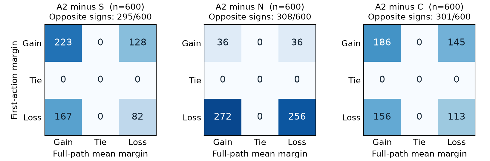

# A2는 무엇을 얻고 무엇을 잃는가

**기존 600개 시드 전체를 분석했습니다. A2는 특정 보상 항에서 얻고 다른 벌점에서 잃는 후보이며, 최초 선택의 이득이 전체 성능을 보장하지 않습니다.**

[논문 PDF](paper.pdf) · [상세 분석](all_seeds_report_ko.md) · [코드·입력·전체 결과](a2-all-seeds-analysis-v1.9.0.zip)

## 가까운 대안과 비교

| 정책 | 실제 식 | 노드 | 선택 U | 시험 U |
| --- | --- | ---: | ---: | ---: |
| A2 | `temp+(0.5*(soc*imped)+stress*stress*stress)` | 13 | 1.011889 | 1.011170 |
| S | `temp+stress*stress*stress` | 7 | 1.010594 | 1.009897 |
| N | `temp+0.5*soc*imped+1.5*max(stress-0.5,0)` | 15 | 1.011573 | 1.011015 |
| C | `temp+stress*stress*stress+0.1*soc*imped` | 13 | 1.011253 | 1.010659 |

S는 단순식, N은 선택 평균 최상위 중립식, C는 같은 크기의 세제곱·곱 결합식입니다. A2의 관측 결과는 각각 390승·210패, 308승·292패, 342승·258패입니다. N보다 2노드 작지만 평균 차이는 작습니다. 식 크기는 실행 속도가 아닙니다.

## 보상은 어디에서 생겼나

| A2 대비 대안 | 위험 지표 보상 기여 | 불필요 동작 벌점 기여 | 팩 상태 벌점 기여 | 하한 보정 | 합계 |
| --- | ---: | ---: | ---: | ---: | ---: |
| S | +0.003571714 | -0.000419271 | -0.001517325 | +0.000000000 | +0.001635119 |
| N | +0.000749506 | -0.000471354 | -0.000079824 | +0.000000000 | +0.000198327 |
| C | +0.002263473 | -0.000388021 | -0.001219317 | +0.000000000 | +0.000656135 |

각 행은 기존 600개 시드 전체의 원시 보상 차이이며 백분율이 아닙니다. S 대비 위험 지표 보상은 500개에서 유리하지만 팩 벌점은 594개에서 불리했습니다. 이는 실측 안전 개선이 아니라 설계된 합성 보상함수 안의 교환관계입니다.

## 첫 선택이 좋아 보여도 끝까지 좋은 것은 아니다

N 대비 처음 손해인 528개 중 272개는 전체 경로에서 이득, 처음 이득인 72개 중 36개는 전체 경로에서 손실입니다. 세 대안 모두 약 절반에서 첫 선택과 전체 경로의 손익 부호가 달랐습니다. 최초 선택 이후에는 상태가 달라지므로 이 차이를 한 선택의 인과 효과로 해석하지 않습니다.

선택 전환 규칙은 곱 항의 점수 이득이 기존 점수 열세를 넘는 경우입니다. 논문은 실제 이득·손실 입력, 정확한 보상함수, 전체 1,800개 비교를 함께 제공합니다. 기존 여섯 예시도 보존했습니다.

## 연구 주제와 한계

생물학·HCI 탐색과 미니멀 디자인 지침을 결합한 프롬프트에서 어떤 식이 나왔고, 대안에 비해 왜 검토할 만한지를 살피는 탐색 연구입니다. 도메인 결합의 효과를 입증한 연구는 아닙니다. 곱 항은 입력 힌트·보상식과 겹치며, 세제곱은 중립 조건에서도 나왔습니다. A1의 판단 변화, 다섯 사례, 원래 전체 대비 −0.1111을 유지했습니다.

새 모델 호출·새 시드·새 독립 표본은 없습니다. 2,400개 저장 보상과 기준식 600개가 모두 정확히 재현됐습니다. [검증 결과](all_seeds_verification.json) · [해시](SHA256SUMS.txt) · [이전 실제 경로 사례](../v1.8.0/case_highlights_ko.md) · [전체 산출물 목록](https://github.com/7065616b/symbolic-policy-framing-pilot/releases/download/v1.3.0/catalog.html)
